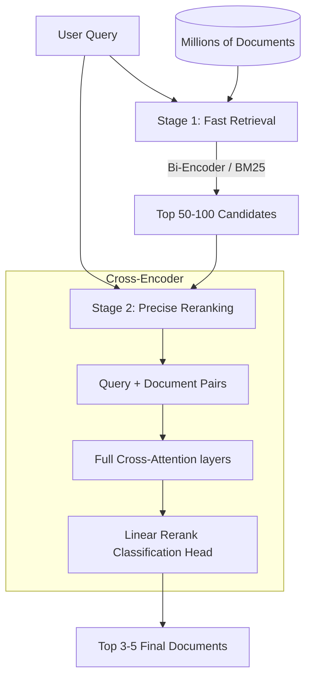

# cross-encoder-reranker

High-precision reranking module (Reranker) based on the Cross-Encoder architecture of Transformer neural networks.

This component acts as the second stage (Stage-2) in semantic search systems and Retrieval-Augmented Generation (RAG) pipelines. It receives a preliminary list of candidate documents quickly retrieved by first-stage methods (such as vector search or BM25) and computes an exhaustive cross-attention score to rank the items, reducing noise and injecting only the most genuinely relevant context into the LLM's context window.

## Architecture and Theoretical Foundations

The two-phase retrieval design resolves the trade-off between computational cost and semantic precision.



### 1. Comparison: Bi-Encoder vs Cross-Encoder

The difference lies in how the query and the document interact within the Transformer model:

*   **Bi-Encoder (Stage 1 - Retrieval):** Encodes the query $Q$ and the document $D$ separately:
    $$\mathbf{u} = \text{Transformer}(Q), \quad \mathbf{v} = \text{Transformer}(D)$$
    Similarity is estimated via a simple operation on the resulting vectors:
    $$\text{sim}(Q, D) = \cos(\mathbf{u}, \mathbf{v}) = \frac{\mathbf{u} \cdot \mathbf{v}}{\|\mathbf{u}\| \|\mathbf{v}\|}$$
    *Complexity:* $O(L_Q + L_D)$ at inference. Since there is no interaction between the terms of $Q$ and $D$ during the self-attention layers, fine-grained syntactic relationships and contextual precision are lost.
*   **Cross-Encoder (Stage 2 - Reranking):** Feeds the Transformer with the joint sequence of both texts:
    $$\mathbf{x} = [CLS] + Q + [SEP] + D + [SEP]$$
    *Complexity:* $O((L_Q + L_D)^2)$ due to computing the attention matrix over the unified sequence. Each query token can directly interact with every document token across all layers of the model, making it possible to identify negations, conditional synonyms, and deep thematic correlations.

### 2. Paired Sequence Classification

The classification token $[CLS]$ accumulates the aggregated representation of the entire cross sequence. The final output is projected through a linear layer to obtain a scalar relevance logit:

$$s(Q, D) = W \cdot \mathbf{h}_{[CLS]} + b$$

Where $\mathbf{h}_{[CLS]}$ is the hidden state vector of the $[CLS]$ token in the last layer of the Transformer, $W$ is the weight matrix of the sequence head projection, and $b$ is the bias. Since this is a regression task (typically trained on datasets such as MS MARCO), the resulting scores are not bounded between $0$ and $1$, representing the logarithmic affinity of the query.

### 3. Offline Fallback Logic (Lexical Overlap Algorithm)

To ensure resilience in resource-constrained local environments, the module includes a normalized lexical similarity heuristic engine that activates if the Deep Learning dependencies (`torch`, `transformers`) are not present or the pre-trained model fails to load:

$$\text{Score}_{\text{offline}}(Q, D) = 5.0 \cdot \left( \frac{|Q_{\text{tokens}} \cap D_{\text{tokens}}|}{|Q_{\text{tokens}}|} \right) + \frac{|Q_{\text{tokens}} \cap D_{\text{tokens}}|}{|D_{\text{tokens}}|}$$

Where:
*   The first term calculates the proportion of query terms present in the document, scaled by a multiplying factor of `5.0`.
*   The second term acts as a density bonus, prioritizing more concise documents that condense the answer, reducing the weight if the document contains an excess of irrelevant words.

## Connection to the Ecosystem

This module optimizes the responses of other components in the ecosystem:
1.  **hybrid-search-retrieval-pipeline:** Receives the preliminary list of candidates returned by RRF or Score Normalization (e.g., 30 candidates). The Reranker applies Cross-Encoder analysis and reduces this set to the 3-5 documents with the highest empirical relevance.
2.  **General RAG Orchestrator:** Acts as an intermediate filtering pass before feeding the LLM's synthesis prompt, reducing processing costs (input tokens) and mitigating the "lost in the middle" phenomenon, where language models tend to ignore information located in the central portion of excessively long prompts.

## Project Structure

*   `reranker.py`: Contains the `CrossEncoderReranker` class, which implements hardware selection logic, bidirectional tokenization, inference via PyTorch, and the offline lexical overlap fallback.
*   `test_reranker.py`: Automated test suite that verifies the correct functioning of the offline scoring functions and the inference pipeline integration using tensor simulation.
*   `example.py`: Executable demonstration that processes a query over several conceptually disparate candidates, printing the change in ranking order caused by the reranking.

## Installation and Requirements

### 1. Activate the Virtual Environment and Install Dependencies

Make sure to install the required dependencies to support running Hugging Face models:

```bash
python3 -m venv .venv
source .venv/bin/activate
pip install -r requirements.txt
```

### 2. Run Unit Tests

To check the local score computation algorithms and hardware device control:

```bash
.venv/bin/python -m unittest test_reranker.py
```

### 3. Run Demo Code

To verify Cross-Encoder inference (`ms-marco-MiniLM-L-6-v2`) on CPU or local accelerators (MPS/CUDA):

```bash
.venv/bin/python example.py
```
